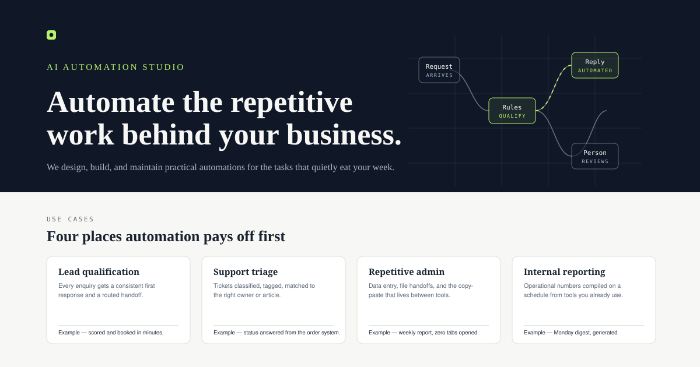

# AgencyLaunch Kit

**Your AI Automation Business. Ready for the Web.**

A customizable website foundation for AI automation entrepreneurs — license it, adapt it, deploy it yourself.



> **Licensing:** this repository is public for inspection, not open source. Viewing the code is free; **commercial use requires an explicit written license.** See [Commercial licensing](#commercial-licensing) or email **Maverick_Limitless@icloud.com**.

## The elevator pitch

AgencyLaunch Kit is a website starter project for AI automation entrepreneurs who want a professional web presence without building every foundational page and interaction from scratch. Inspect the source, understand the implementation, and request a commercial license to adapt the project to your business. You deploy and operate your own website; the standard offering is source code, not a hosted service.

## The problem

An AI automation entrepreneur may be excellent at automation but still need a credible website to explain their services, communicate their value, and give prospective customers a clear path to make contact. Building that initial web presence from scratch takes time and requires design and implementation work that may not be the entrepreneur's main strength.

## The solution

AgencyLaunch Kit provides an existing website foundation that a buyer can inspect here, license, customize, and deploy in their own environment. Everything described below is grounded in the actual source code in this repository — no builder, no service, no hidden dependencies.

## Who the project is for

- Independent AI automation consultants who need a professional web presence.
- Small AI automation agencies launching or replacing a website.
- Solo consultants and freelancers selling automation or workflow-integration services.
- Small service businesses that need a clear way to explain services and communicate value.

## What is actually included

| Deliverable | Detail |
| --- | --- |
| Complete landing page | Hero with original SVG process diagram, working principles, 4 use-case cards, 4-step process, ROI calculator, 3 service cards, 3 example packages, 6 FAQ disclosures, contact section, footer |
| ROI calculator | 6 validated inputs; calculations run entirely in the browser; live formatted results; reset; explicit "no payback" handling; no storage or network use |
| Responsive navigation | Sticky header with an accessible mobile menu |
| Design system | CSS custom properties (navy / off-white / ink / lime); system font stacks; `clamp()` type scale |
| Original assets | `assets/favicon.svg`, `assets/preview.svg` — hand-authored SVG |
| Documentation | Setup, customization, testing, deployment, licensing, third-party notices |
| Test suite | 113 automated checks (calculator unit tests, static checks, contrast checks, browser checks) |

## Benefits

- A starting point instead of a blank project.
- Existing source code that can be inspected before a licensing decision.
- A customizable foundation for an AI automation business's online presence.
- Control over your own deployment and hosting.
- A source-code purchase model without a mandatory AgencyLaunch Kit hosting subscription.
- Transparent scope: you know what you receive and what remains your responsibility.

## Benefits and practical limitations

What this product does **not** do — stated plainly:

- No guaranteed leads, clients, revenue, conversions, search rankings, or business growth.
- No hosting, domain, deployment, maintenance, or support (unless separately agreed in writing).
- No analytics, tracking, cookies, or consent machinery — by design.
- The ROI calculator is an arithmetic estimator, not financial advice or accounting software.
- The shipped content is example content — copy, services, and package prices are editable placeholders.

## Preview

[`assets/preview.svg`](assets/preview.svg) is a genuine render of the template's key sections. To preview the real thing, follow the local setup below.

## Technology stack

Grounded in the actual files:

- Semantic HTML5 (`index.html`) — no templating language.
- Modern CSS (`styles.css`) — custom properties, `clamp()`, no preprocessor needed.
- Vanilla JavaScript (`script.js`) — no framework, no libraries, no imports.
- Original inline SVG for all graphics.
- Native browser APIs only (`Intl.NumberFormat`, `matchMedia`, `IntersectionObserver`-free motion).
- Node.js built-in test runner for tests (`node:test`) — development only, not a runtime dependency.

There is no build step, no bundler, and no package manifest dependency list: the site is served as-is.

## Local setup (tested)

```bash
git clone https://github.com/scottyqzhconron55-sudo/AgencyLaunch-Kit.git
cd AgencyLaunch-Kit
python3 -m http.server 8000
# open http://127.0.0.1:8000
```

Verified working with Python 3.14. Any static file server (`npx serve`, nginx, VS Code Live Server) works identically.

## Customization

[`docs/CUSTOMIZATION.md`](docs/CUSTOMIZATION.md) covers brand name, hero copy, services, sample pricing, contact email, color tokens, typography, navigation, FAQ content, and calculator defaults. In short: content lives in `index.html`, design tokens at the top of `styles.css`, calculator defaults and limits in `script.js`.

## Testing (tested)

```bash
node --test tests/calculator.test.js     # 20 calculator unit tests
node --test tests/smoke-checks.js        # 16 static checks
node --test tests/contrast-checks.js     # 5 WCAG contrast checks
```

The browser suite (`tests/browser-checks.js`, 24 checks per engine, Chromium/Firefox/WebKit) needs Playwright installed outside the package. Commands, prerequisites, expected output, and limitations: [`docs/TESTING.md`](docs/TESTING.md). Actual results: [`TEST-REPORT.md`](TEST-REPORT.md).

## Deployment

The site is static files. Upload the contents to any static host (GitHub Pages, Netlify, Cloudflare Pages, S3, traditional web hosting, or your own server) and serve — no build, no backend. Host-agnostic instructions: [`docs/DEPLOYMENT.md`](docs/DEPLOYMENT.md).

Deploying, hosting, operating, and maintaining the resulting website are your responsibility.

## Commercial licensing

**Source-available, proprietary — not open source.** Public visibility of this repository is for inspection and evaluation. It grants no commercial-use rights. Without an explicit written license you may not deploy, modify, redistribute, resell, or commercially use the template. Full terms: [`LICENSE.txt`](LICENSE.txt).

## Pricing philosophy

**Straightforward, low-cost licensing. One source-code purchase, your own deployment, no mandatory AgencyLaunch Kit hosting subscription.**

We aim to make a useful website foundation accessible at a low upfront cost. The final price depends on the license scope agreed in writing — it is confirmed per grant in `docs/COMMERCIAL-LICENSE.md`, not announced on this page. No price is final until your written agreement states it.

## How to request a commercial license

**Email Maverick_Limitless@icloud.com** with:

1. Your intended use.
2. Your business or the client/project involved.
3. The number of websites or deployments you need.
4. Any modification or client-delivery requirements.

The process: inspect this repository → email your intended use → discuss the required rights and scope → receive explicit written authorization with the final agreed terms → receive the files covered by the agreement → deploy independently. An email inquiry alone does not grant a license. Consumer guidance: [`docs/LICENSE-GUIDANCE.md`](docs/LICENSE-GUIDANCE.md); grant template: [`docs/COMMERCIAL-LICENSE.md`](docs/COMMERCIAL-LICENSE.md).

## Ownership and attribution

AgencyLaunch Kit is original work by **Maverick Limitless**, who retains copyright and all intellectual-property rights. Public visibility of the repository does not transfer ownership, and no ownership is transferred by a license either — a license grants the specific rights its written terms state, and nothing more.

## Third-party notices

The project contains no third-party components, fonts, images, scripts, or services. The full audit and its verification method: [`docs/THIRD-PARTY-NOTICES.md`](docs/THIRD-PARTY-NOTICES.md). The test suite fails the build if an external resource or credential is introduced.

## Testing status

113 automated checks pass: 20 calculator unit tests, 16 static checks, 5 WCAG contrast checks, and 24 browser checks on each of Chromium, Firefox, and WebKit. Recorded results, including what was **not** run (screen-reader testing, real-device gestures, production deployment), are in [`TEST-REPORT.md`](TEST-REPORT.md).

## Security reporting

If you believe you have found a security issue in this project, report it privately to **Maverick_Limitless@icloud.com** with a description and reproduction steps. Please do not open a public issue for it. Be aware that this is a licensing and project contact address, not a monitored security-intake service: no response time or bounty is promised. Do not include real credentials or personal data in your report.

## Disclaimer

AgencyLaunch Kit is a website foundation, not a guarantee of business outcomes. It does not promise customers, revenue, conversions, rankings, or savings. It has not been reviewed by a lawyer, and nothing in this repository is legal advice.

## Documentation map

| File | Contents |
| --- | --- |
| [`LICENSE.txt`](LICENSE.txt) | The proprietary source-available license — authoritative terms |
| [`CHANGELOG.md`](CHANGELOG.md) | Release history |
| [`TEST-REPORT.md`](TEST-REPORT.md) | Verification evidence and its limitations |
| [`docs/LICENSE-GUIDANCE.md`](docs/LICENSE-GUIDANCE.md) | Licensing questions, consumer-facing |
| [`docs/COMMERCIAL-LICENSE.md`](docs/COMMERCIAL-LICENSE.md) | Per-licensee grant template |
| [`docs/DEPLOYMENT.md`](docs/DEPLOYMENT.md) | Host-agnostic deployment |
| [`docs/CUSTOMIZATION.md`](docs/CUSTOMIZATION.md) | How to adapt the template |
| [`docs/TESTING.md`](docs/TESTING.md) | Test commands and expectations |
| [`docs/THIRD-PARTY-NOTICES.md`](docs/THIRD-PARTY-NOTICES.md) | Third-party audit result |

---

© 2026 Maverick Limitless. AgencyLaunch Kit is original work; commercial use requires an explicit written license. Licensing contact: **Maverick_Limitless@icloud.com**
